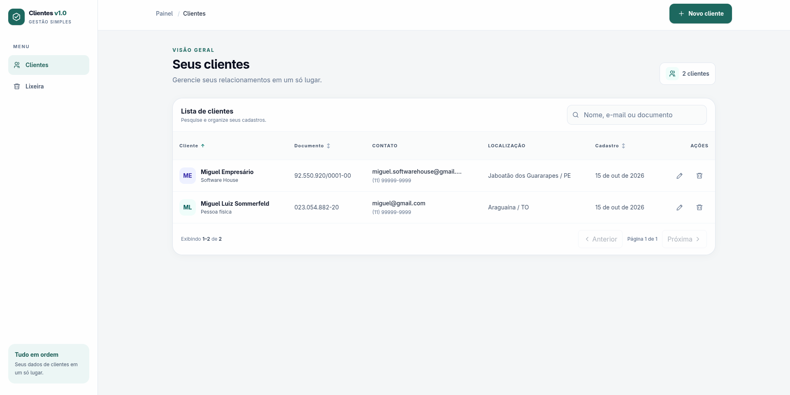
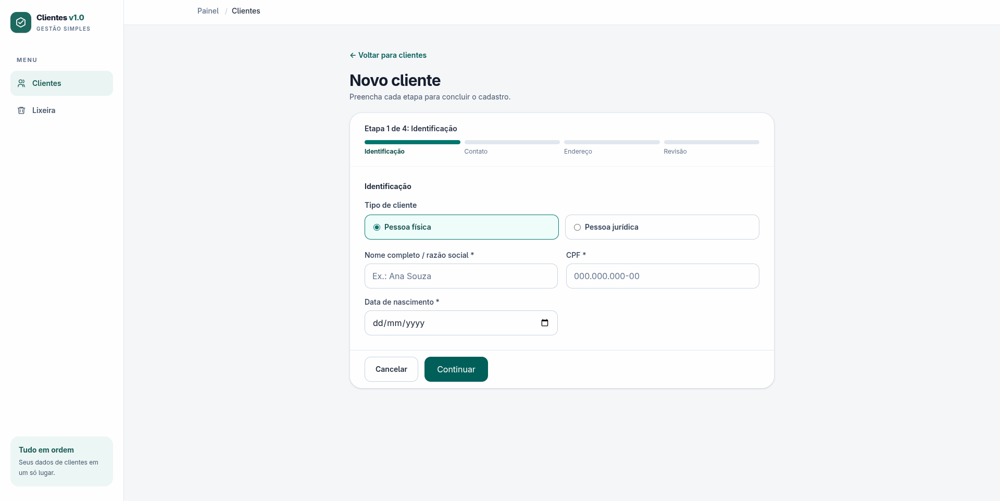
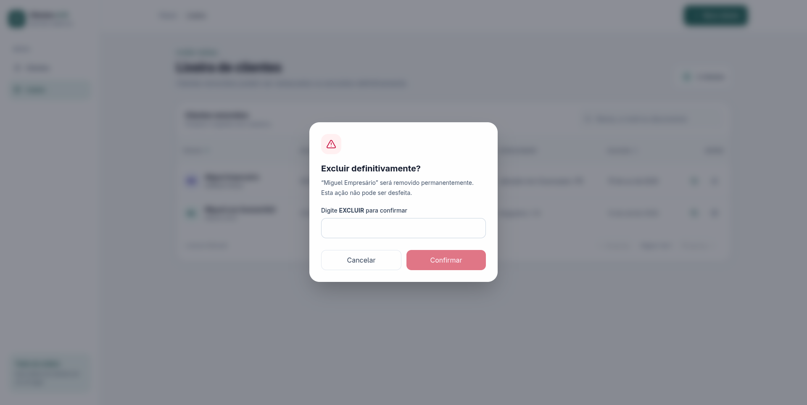

# Cadastro de Clientes

Aplicação para cadastro e gerenciamento de clientes pessoa física e pessoa jurídica. O projeto está organizado como um monorepo: uma API REST, uma interface web e contratos compartilhados entre os pacotes.

> **Documentação interativa:** a API usa Swagger. Inicie a aplicação e acesse [`http://localhost:3333/docs`](http://localhost:3333/docs) para consultar os detalhes dos endpoints e experimentar as requisições.

## Conteúdo

- [Funcionalidades](#funcionalidades)
- [Stack](#stack)
- [Estrutura do projeto](#estrutura-do-projeto)
- [Pré-requisitos](#pré-requisitos)
- [Configuração e inicialização](#configuração-e-inicialização)
- [URLs locais](#urls-locais)
- [Front-end](#front-end)
- [API](#api)
- [Modelos e validações](#modelos-e-validações)
- [Comandos úteis](#comandos-úteis)

## Funcionalidades

- Cadastro de clientes pessoa física (CPF) e pessoa jurídica (CNPJ).
- Cadastro em wizard de quatro etapas, com revisão final, máscaras e preenchimento do endereço pelo CEP.
- Cadastro de endereço associado ao cliente.
- Edição de cliente, listagem e lixeira em rotas próprias, com layout adaptado a celular e desktop.
- Consulta de clientes ativos e consulta individual por ID.
- Atualização parcial dos dados de um cliente.
- Remoção lógica, listagem de clientes removidos e restauração.
- Exclusão permanente de clientes removidos.
- Verificação de saúde da API e documentação interativa via Swagger.
- Cadastro de conta e tenant, login e manutenção de sessão com JWT e cookies seguros.

As telas ficam disponíveis em:

- `/` — clientes.
- `/clientes/novo` — cadastro em quatro etapas.
- `/clientes/:id/editar` — edição.
- `/lixeira` — clientes removidos.

Caminhos desconhecidos exibem uma página 404.

## Stack

| Camada | Tecnologias |
| --- | --- |
| API | Node.js 24, TypeScript, Fastify 5, Zod |
| Documentação da API | OpenAPI e Swagger UI (`@fastify/swagger`) |
| Persistência | PostgreSQL 18, Prisma ORM |
| Interface web | React 19, TypeScript, Vite 8 |
| Servidor web | Nginx |
| Execução local | Docker e Docker Compose |

## Estrutura do projeto

```text
.
├── apps/
│   ├── api/
│   │   ├── prisma/             # Contrato do banco e migrações
│   │   └── src/
│   │       ├── controllers/    # Coordenação das operações da API
│   │       ├── helpers/        # Validações auxiliares
│   │       ├── models/         # Acesso e operações sobre os dados
│   │       ├── repositories/   # Camada de repositório
│   │       ├── routes/         # Rotas Fastify
│   │       └── services/       # Regras de negócio
│   └── web/                    # Interface React servida pelo Nginx
├── packages/
│   └── contracts/              # Schemas Zod compartilhados
├── docker-compose.yml
├── start.sh                    # Inicialização e comandos auxiliares
└── .env.example
```

## Pré-requisitos

- Docker Engine ou Docker Desktop em execução.
- Docker Compose v2 ou superior.

O script `start.sh` verifica os pré-requisitos antes de iniciar os serviços. Não é necessário instalar Node.js ou PostgreSQL na máquina para usar a configuração via Docker Compose.

## Configuração e inicialização

1. Crie o arquivo local de configuração:

   ```bash
   cp .env.example .env
   ```

2. Edite `.env` e defina os valores de banco de dados. Os campos abaixo devem ser consistentes entre si:

   ```dotenv
   DB_NAME=cadastro_clientes
   DB_USER=usuario
   DB_PASSWORD=senha_local
   DB_URL=postgresql://${DB_USER}:${DB_PASSWORD}$@db:5432/${DB_NAME}
   ```

   `DB_URL` é a URL usada pela API e pelas migrações. No ambiente do Compose, o host do banco é `db`. Use uma senha local segura e mantenha o arquivo `.env` fora do controle de versão.
   Configure também `JWT_SECRET` com pelo menos 32 caracteres aleatórios, por exemplo com `openssl rand -base64 32`.
   O `.env.example` define `NODE_ENV=development` para uso local; em outros ambientes, use `NODE_ENV=production` para ativar o atributo `Secure` nos cookies.

3. Inicie a aplicação a partir da raiz do repositório:

   ```bash
   ./start.sh
   ```

   O script constrói as imagens, inicia PostgreSQL, API e interface web, aplica as migrações do banco e aguarda a API ficar saudável. Na primeira execução, o Docker pode levar alguns minutos para baixar imagens e construir os serviços.

## URLs locais

| Serviço | URL |
| --- | --- |
| Interface web | [`http://localhost:8080`](http://localhost:8080) |
| API | [`http://localhost:3333`](http://localhost:3333) |
| Swagger UI | [`http://localhost:3333/docs`](http://localhost:3333/docs) |
| Health check | [`http://localhost:3333/health`](http://localhost:3333/health) |

## Front-end

A interface foi desenvolvida em React e TypeScript e se adapta a telas grandes e pequenas. No desktop, a navegação fica em uma barra lateral; em dispositivos móveis, ela passa para a parte inferior da tela. O painel concentra o acesso aos clientes ativos e à lixeira, com estados de carregamento, lista vazia, falha de conexão e resultados de busca.

### Telas e recursos

| Tela | Endereço | O que você pode fazer |
| --- | --- | --- |
| Clientes | `/` | Consultar a quantidade de registros, buscar por nome, e-mail ou documento, ordenar e navegar pela lista paginada. Cada cadastro pode ser editado ou movido para a lixeira. |
| Novo cliente | `/clientes/novo` | Cadastrar pessoa física ou jurídica em quatro etapas: identificação, contato, endereço e revisão dos dados. O preenchimento do endereço pode buscar os dados pelo CEP. |
| Editar cliente | `/clientes/:id/editar` | Atualizar os dados permitidos de um cadastro existente. O tipo de pessoa e o documento são preservados. |
| Lixeira | `/lixeira` | Consultar clientes removidos, restaurá-los ou excluí-los definitivamente. As ações de remoção pedem confirmação. |

O cadastro valida os campos em cada etapa e apresenta os erros junto aos campos correspondentes. Antes de concluir, a etapa de revisão permite conferir e voltar para corrigir os dados. Os formulários também oferecem navegação por teclado, rótulos associados aos campos e mensagens de estado para tecnologias assistivas.

### Capturas de tela

As imagens abaixo mostram o estado da interface no momento da captura; os registros exibidos podem variar conforme os dados do banco.

**Painel de clientes**



**Formulário de cadastro**



**Lixeira**



### Executar o front-end em desenvolvimento

O Vite carrega as configurações do `.env` localizado na raiz do monorepo. Instale as dependências a partir dessa raiz, se ainda não tiver feito isso, e inicie o servidor web:

```bash
npm install
cd apps/web
npm run dev
```

Com a API em execução, abra a URL local informada pelo Vite (normalmente [`http://localhost:5173`](http://localhost:5173)). O proxy de desenvolvimento encaminha as chamadas para a API conforme `VITE_API_PROXY_TARGET`.

### Configuração

Defina no `.env` da raiz as variáveis que forem necessárias:

| Variável | Uso |
| --- | --- |
| `VITE_API_BASE_URL` | Prefixo base da API usado pelo navegador, por exemplo `/api/v1`. |
| `VITE_API_CUSTOMERS_PATH` | Rota de clientes ativos. |
| `VITE_API_DELETED_CUSTOMERS_PATH` | Rota de clientes removidos. |
| `VITE_API_CUSTOMER_RESTORE_PATH` | Rota para restaurar um cliente. |
| `VITE_API_CUSTOMER_PERMANENT_DELETE_PATH` | Rota para excluir permanentemente um cliente. |
| `VITE_API_PROXY_TARGET` | Destino do proxy do Vite durante o desenvolvimento local. |
| `API_PROXY_PREFIX` | Prefixo de URL encaminhado pelo Nginx no contêiner web. |
| `API_PROXY_TARGET` | Serviço e porta da API usados pelo Nginx no contêiner web. |

Os valores `VITE_*` são incorporados ao código entregue ao navegador durante a execução do Vite ou a construção da imagem Docker; não coloque segredos nessas variáveis.

## API

As rotas de clientes usam o prefixo `/api/v1`. A URL base é:

```text
http://localhost:3333/api/v1
```

As rotas de clientes exigem o cookie `access_token`; o tenant usado nas consultas vem exclusivamente do JWT. `ADMIN` pode executar todas as ações, `OPERATOR` pode ler, cadastrar, editar, mover e restaurar clientes, e `VIEWER` pode apenas consultar. Clientes de outro tenant respondem como não encontrados.

### Rotas disponíveis

| Método | Caminho | Parâmetros | Descrição |
| --- | --- | --- | --- |
| `GET` | `/health` | — | Verifica a disponibilidade da API e do banco. Retorna `200` ou `503`. |
| `POST` | `/api/v1/auth/register` | Corpo JSON com dados do tenant e do usuário | Cria tenant e usuário `ADMIN`, inicia a sessão e define cookies httpOnly. |
| `POST` | `/api/v1/auth/login` | E-mail e senha | Valida as credenciais e define cookies httpOnly; limite de 5 tentativas por minuto por IP/e-mail. |
| `POST` | `/api/v1/auth/refresh` | Cookie `refresh_token` | Faz a rotação do refresh token e emite novo access token. |
| `POST` | `/api/v1/auth/logout` | Cookies de autenticação | Revoga a sessão e limpa os cookies; a operação é idempotente. |
| `GET` | `/api/v1/auth/session` | Cookie `access_token` | Retorna o usuário, tenant, role e permissões, ou `null` se não houver sessão válida. |
| `GET` | `/api/v1/customers` | Query opcional `id` | Lista clientes ativos; com `id`, retorna um cliente. Retorna `404` se o ID não for encontrado entre os ativos. |
| `GET` | `/api/v1/customers/deleted` | — | Lista clientes na lixeira (removidos logicamente). |
| `POST` | `/api/v1/customers` | Corpo JSON | Cadastra um cliente e seu endereço. Retorna `201` quando criado. |
| `PATCH` | `/api/v1/customers?id={id}` | Query obrigatória `id`; corpo JSON parcial | Atualiza os campos enviados. |
| `DELETE` | `/api/v1/customers?id={id}` | Query obrigatória `id` | Move o cliente ativo para a lixeira. Retorna `204` sem corpo. |
| `POST` | `/api/v1/customers/restore?id={id}` | Query obrigatória `id` | Restaura um cliente da lixeira. Retorna `200` sem corpo. |
| `DELETE` | `/api/v1/customers/permanent?id={id}` | Query obrigatória `id` | Exclui permanentemente um cliente que esteja na lixeira. Retorna `204` sem corpo. |

Os parâmetros `id` são enviados na query string, por exemplo:

```text
GET    /api/v1/customers?id=8da62e8d-7cdd-432b-b828-3722fb6e791b
PATCH  /api/v1/customers?id=8da62e8d-7cdd-432b-b828-3722fb6e791b
DELETE /api/v1/customers?id=8da62e8d-7cdd-432b-b828-3722fb6e791b
```

### Cadastrar cliente

Envie `personType` como `INDIVIDUAL` ou `COMPANY`. O endereço é obrigatório no cadastro.

Exemplo de pessoa física:

```http
POST /api/v1/customers
Content-Type: application/json
```

```json
{
  "personType": "INDIVIDUAL",
  "name": "Maria da Silva",
  "document": "529.982.247-25",
  "email": "maria@example.com",
  "phone": "+55 (11) 99999-9999",
  "birthDate": "1990-05-20",
  "address": {
    "zipCode": "01310-100",
    "street": "Avenida Paulista",
    "number": "1000",
    "complement": "Apto 12",
    "district": "Bela Vista",
    "city": "São Paulo",
    "state": "SP"
  }
}
```

Para pessoa jurídica, use `"personType": "COMPANY"` e um CNPJ válido no campo `document`. `tradeName` (nome fantasia) é opcional. `birthDate` é específico de pessoa física.

### Atualizar cliente

O `PATCH` aceita os campos que serão alterados, sem exigir o objeto completo. Para o endereço, o campo atualizável é `address.number`.

```http
PATCH /api/v1/customers?id=8da62e8d-7cdd-432b-b828-3722fb6e791b
Content-Type: application/json
```

```json
{
  "phone": "+55 (11) 98888-7777",
  "address": {
    "number": "120"
  }
}
```

### Respostas

As consultas e o cadastro retornam os dados do cliente, incluindo `id`, `personType`, `name`, `document`, `phone`, `address`, `createdAt` e `deletedAt`. Também podem retornar `email`, `updatedAt`, `birthDate` (pessoa física) ou `tradeName` (pessoa jurídica).

Erros de validação e de operação incluem uma mensagem descritiva. Entre os status usados pela API estão `400` (dados ou parâmetros inválidos), `404` (cliente não encontrado), `409` (conflito de cadastro) e `503` (serviço indisponível no health check). Consulte o Swagger para os schemas e respostas documentados de cada rota.

Os tokens de autenticação são enviados somente em cookies `httpOnly` com `SameSite=Strict`; em produção, também usam `Secure`. O access token expira em 15 minutos e o refresh token em 7 dias. O logout revoga o refresh token; um access token já emitido pode continuar válido por até 15 minutos.

## Modelos e validações

- **Pessoa física:** CPF válido, nome com 3 a 150 caracteres, e-mail válido, telefone brasileiro e data de nascimento entre `1900-01-01` e a data atual.
- **Pessoa jurídica:** CNPJ válido; nome fantasia é opcional.
- **Documento:** único dentro de cada tenant. O e-mail de cliente mantém unicidade global.
- **Telefone:** validado como número brasileiro e armazenado apenas com dígitos.
- **Endereço:** CEP com 8 dígitos (com ou sem hífen) e UF correspondente a um estado brasileiro.
- **Remoção lógica:** o cliente permanece armazenado e pode ser consultado na lixeira e restaurado.
- **Exclusão permanente:** remove também o endereço associado e não pode ser desfeita.

## Comandos úteis

```bash
./start.sh --help   # Exibe as opções disponíveis
./start.sh --logs   # Acompanha os logs dos serviços
./start.sh --stop   # Para os serviços, preservando os dados
./start.sh --reset  # Apaga os volumes do banco e inicia tudo novamente
```

> **Atenção:** `./start.sh --reset` apaga permanentemente os dados persistidos no banco. O script solicita que você digite `RESET` antes de continuar.

Os pacotes também têm comandos próprios:

| Diretório | Comando | Descrição |
| --- | --- | --- |
| `apps/api` | `npm run dev` | Inicia a API em modo de desenvolvimento. |
| `apps/api` | `npm run build` | Executa a verificação TypeScript de produção. |
| `apps/api` | `npm start` | Inicia a API compilada. |
| `apps/web` | `npm run dev` | Inicia o servidor de desenvolvimento Vite. |
| `apps/web` | `npm run build` | Verifica os tipos e gera a versão de produção. |